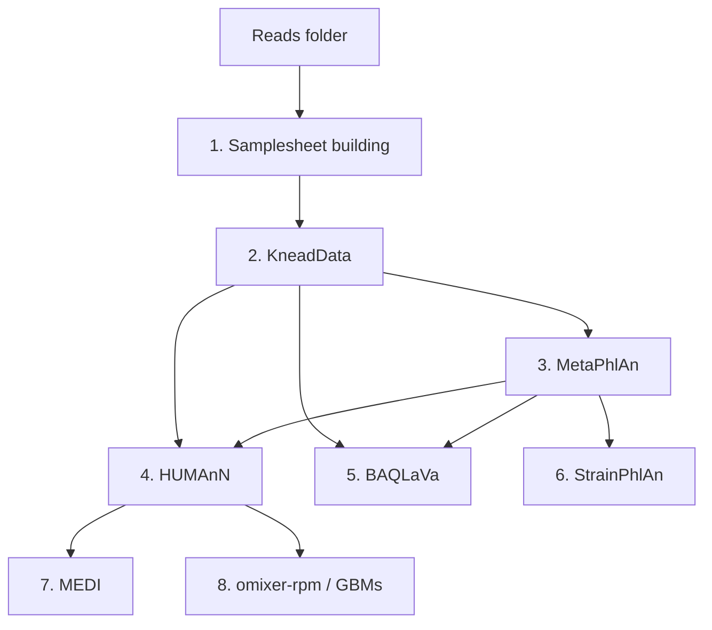

# FORM pipeline

FORM orchestrates a pinned bioBakery workflow and downstream analyses for
metagenomic reads. This documentation follows the intended analysis order and
records the software, major dependencies, database sources, and SHA256 evidence
for each component.

## Pipeline stages

| Order | Component | Role | Integration state |
| --- | --- | --- | --- |
| 1 | [Samplesheet building](stages/01-samplesheet.md) | Discover reads and construct a validated sample manifest | FORM module planned |
| 2 | [KneadData](stages/02-kneaddata.md) | Read quality control and host depletion | Imported through bioBakery |
| 3 | [MetaPhlAn](stages/03-metaphlan.md) | Microbial taxonomic profiles and marker alignments | Imported through bioBakery |
| 4 | [HUMAnN](stages/04-humann.md) | Functional profiles and nucleotide-unaligned reads | Imported through bioBakery; export interface being updated |
| 5 | [BAQLaVa](stages/05-baqlava.md) | Viral profiling | DNAnexus integration pending the bioBakery re-pin |
| 6 | [StrainPhlAn](stages/06-strainphlan.md) | Cohort strain phylogenies | DNAnexus integration pending the bioBakery re-pin |
| 7 | [MEDI](stages/07-medi.md) | Food DNA and nutrient estimates | FORM modules present; DNAnexus validation pending |
| 8 | [omixer-rpm](stages/08-omixer-rpm.md) | Gut-Brain Module abundance and coverage | FORM module planned |

The order above is the documentation order. The workflow can run independent
branches concurrently:

## Reproducibility baseline

The program-selected KneadData host reference is
[hg39T2T / GCA_009914755.4](reference/kneaddata-host.md), using the Huttenhower
Lab Bowtie2 v0.2 bundle. Its six expected index checksums are recorded in a
downloadable manifest.

This first inventory was recorded on **2026-11-19** while the upstream input
and read-export interfaces were being updated. FORM currently pins bioBakery
to `4466d89aeb5131dd5a99e077d61d0020028377f4`. The inspected DNAnexus images
are candidates from the neighboring deployment, not a validated FORM release.

- [Software versions](reference/versions.md) distinguishes installed versions,
  recipe constraints, source commits, and image tags.
- [Databases and checksums](reference/databases.md) lists every major reference,
  including explicit gaps where the exact deployed bytes are unavailable.
- [Provenance and verification](reference/provenance.md) explains how to reproduce
  the inventory and fill those gaps.
- [DNAnexus interface](reference/dnanexus.md) describes the single `dnanexus`
  profile and the reads-folder/YAML launch interface.

Historical implementation decisions remain under [Design history](specs/index.md).

## Documentation site

The site uses Zensical with searchable navigation, light and dark themes, and
GitHub Pages deployment through GitHub Actions. See
[Writing and publishing docs](development/documentation.md) to preview or update it.
